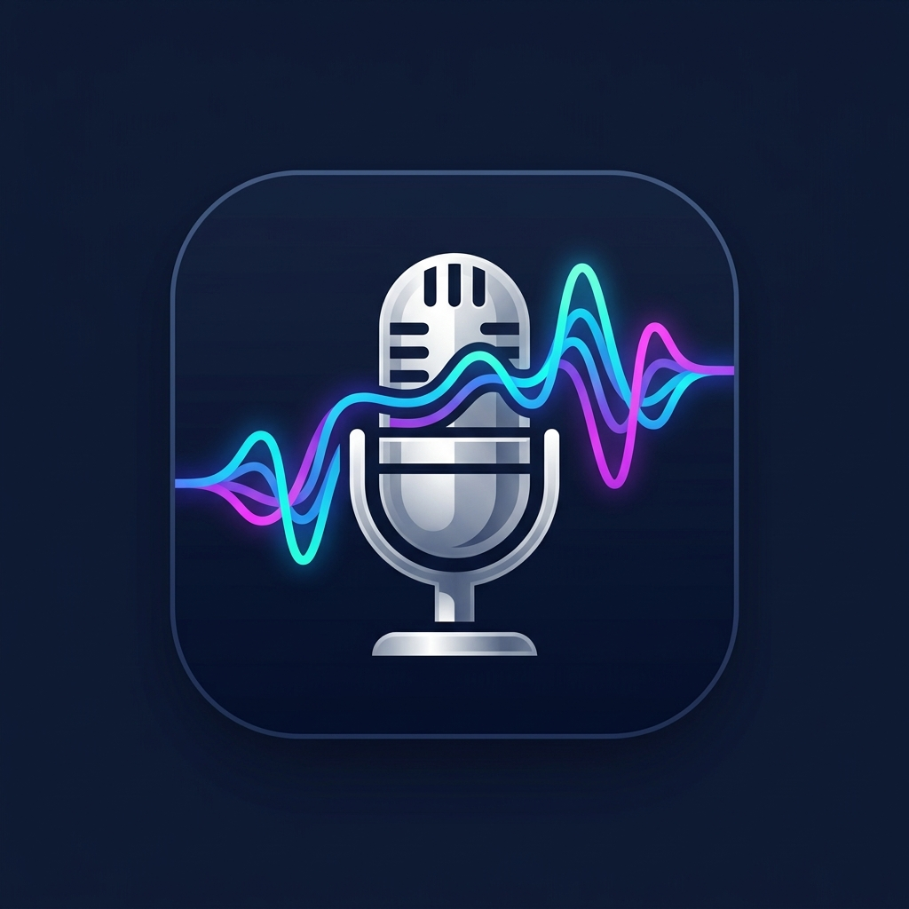

# آوانگار (AvaNegar) - Persian Offline Speech-to-Text with Gemma 4 & LiteRT-LM

<p align="center">
  
</p>

<p align="center">
  <b>اپلیکیشن بومی اندروید جهت تبدیل صوت به متن فارسی به‌صورت کاملاً آفلاین با مدل Gemma 4 E2B</b><br>
  <i>Native Android Offline Speech-to-Text App in Persian (Farsi) using On-Device Gemma 4 E2B and LiteRT-LM</i>
</p>

<p align="center">
  
  
  
  
  
  
</p>

---

## 📖 معرفی پروژه (Overview)

**آوانگار (AvaNegar)** یک برنامه مدرن اندروید است که با استفاده از **Jetpack Compose** و موتور استنتاج محلی **LiteRT-LM** (`com.google.ai.edge.litertlm:litertlm-android`)، صوت ضبط‌شده کاربر را به‌صورت **۱۰۰٪ آفلاین و بدون نیاز به اینترنت** با مدل هوش مصنوعی **Gemma 4 E2B** به متن روان فارسی تبدیل می‌کند.

در این اپلیکیشن به دلیل حفظ کامل حریم خصوصی کاربر و امکان استفاده در محیط‌های ایزوله یا بدون دسترسی به شبکه، مجوز `android.permission.INTERNET` در مانیفست اندروید اصلاً تعریف نشده است؛ بنابراین تضمین می‌شود که هیچ داده یا فایلی از دستگاه خارج نخواهد شد.

---

## ✨ ویژگی‌های کلیدی (Key Features)

- 🎙️ **ضبط صوت با کیفیت بالا و فرمت بهینه:**
  - نمونه‌برداری مستقیم در نرخ **۱۶ کیلوهرتز (16kHz)**، کانال **مونو (Mono)** و رمزگذاری **16-bit PCM**.
  - تبدیل خودکار داده‌های خام PCM به هدر استاندارد ۴۴ بایتی **RIFF WAV**.
  - محاسبه بلادرنگ دامنه صوت (Amplitude) و انیمیشن شکل‌موج (Waveform) هنگام صحبت کردن.

- ✂️ **قطعه‌بندی هوشمند صوت‌های طولانی (Audio Chunking):**
  - مدل Gemma 4 دارای محدودیت پردازش حداکثر ۳۰ ثانیه صوت در هر نوبت است.
  - آوانگار فایل‌های ضبط‌شده بالاتر از ۳۰ ثانیه را به‌صورت خودکار به قطعات مجزای ۲۸ الی ۳۰ ثانیه‌ای تقسیم می‌کند.
  - هر قطعه به‌صورت مستقل در قالب WAV ذخیره شده و پس از پردازش متوالی، متن‌های خروجی به یکدیگر متصل می‌شوند.

- 🧠 **اجرای مدل محلی با LiteRT-LM:**
  - استفاده از کتابخانه رسمی `com.google.ai.edge.litertlm:litertlm-android:0.18.0`.
  - استفاده از پرامپت رسمی ارائه‌شده توسط گوگل برای استخراج متن فارسی:
    ```text
    Transcribe the following speech segment in Persian (Farsi) into Persian text.
    Only output the transcription, with no newlines. Write digits as numbers.
    ```
  - ارسال صوت به مدل از طریق ساختار داده نیتیو `Contents.of(Content.Text(...), Content.AudioBytes(...))`.

- 🎨 **رابط کاربری زیبا و مدرن (Material 3 & RTL):**
  - طراحی کاملاً سازگار با جهت‌بندی راست‌به‌چپ (RTL) زبان فارسی.
  - دکمه ضبط بزرگ با انیمیشن پالس در زمان ضبط.
  - نوار پیشرفت مرحله‌به‌مرحله هنگام تبدیل قطعات صوتی.
  - کادر متن پیاده‌سازی شده با قابلیت ویرایش توسط کاربر، کپی سریع در کلیپ‌بورد، اشتراک‌گذاری سیستمی، و شمارنده کلمات.
  - پنجره مدیریت مدل جهت مشاهده وضعیت، انتخاب فایل مدل، یا فعال‌سازی حالت شبیه‌سازی (Demo Mode).

---

## 🏗️ ساختار پروژه (Project Architecture)

پروژه بر اساس معماری استاندارد و توصیه‌شده **MVVM** توسعه یافته است:

```text
app/src/main/java/com/example/
├── MainActivity.kt                      # اکتیویتی اصلی و نقطه ورود برنامه
├── audio/
│   └── AudioRecorder.kt                 # کلاس ضبط PCM، تولید WAV 16kHz و تقطیع ۳۰ ثانیه‌ای
├── ai/
│   └── GemmaAsrManager.kt               # مدیریت موتور LiteRT-LM، بارگذاری مدل و اجرای استنتاج
└── ui/
    ├── MainViewModel.kt                 # مدیریت وضعیت UI، جریان‌های صوتی و متن
    ├── screens/
    │   └── AsrScreen.kt                 # رابط کاربری با Jetpack Compose و پشتیبانی فارسی
    └── theme/
        ├── Color.kt                     # پالت رنگی مدرن و اختصاصی
        ├── Theme.kt                     # تنظیمات تم تاریک و روشن Material 3
        └── Type.kt                      # تایپوگرافی
```

---

## 🚀 راهنمای نصب و راه‌اندازی فایل مدل (Model Setup)

مدل مورد نیاز، فایل تبدیل‌شده **Gemma 4 E2B** به فرمت **`.litertlm`** است. برای اجرای مدل روی دستگاه می‌توانید از یکی از روش‌های زیر استفاده کنید:

### روش ۱: انتقال به حافظه داخلی اپلیکیشن (توصیه‌شده)
فایل مدل را با نام `gemma-4-e2b.litertlm` در پوشه داخلی اپلیکیشن قرار دهید:
```bash
# از طریق ADB:
adb push gemma-4-e2b.litertlm /sdcard/Android/data/com.aistudio.persianasr.qwvkt/files/gemma-4-e2b.litertlm
```

### روش ۲: انتخاب فایل از حافظه گوشی (In-App Picker)
۱. اپلیکیشن را باز کنید.
۲. روی آیکون تنظیمات (چرخ‌دنده/تنظیمات) در بالای صفحه ضربه بزنید.
۳. گزینه **«انتخاب فایل مدل (.litertlm) از دستگاه»** را انتخاب کرده و فایل دانلودشده خود را انتخاب کنید.

### روش ۳: قرار دادن در پوشه Assets پیش از بیلد
می‌توانید فایل مدل را در مسیر `app/src/main/assets/gemma-4-e2b.litertlm` قرار دهید تا در فایل APK بسته‌بندی شود.

### 🧪 حالت آزمایشی (Demo Mode)
اگر فایل مدل با حجم بالا را هنوز روی دستگاه دانلود نکرده‌اید، با لمس بنر وضعیت در بالای صفحه یا منوی تنظیمات، گزینه **«فعال‌سازی حالت آزمایشی (Demo Mode)»** را انتخاب کنید. در این حالت می‌توانید تمام فرآیند ضبط صدا، شکل‌موج بلادرنگ، تولید فایل صوتی ۱۶ کیلوهرتز و تقسیم قطعات ۳۰ ثانیه‌ای را به‌طور کامل آزمایش کنید.

---

## 📦 فایل نصبی پیش‌ساخته (Pre-built APK)

فایل APK کامپایل‌شده پروژه در ریشه مخزن و در مسیر زیر در دسترس است:

📁 **`build_app/app-debug.apk`**

می‌توانید مستقیماً این فایل را روی دستگاه اندرویدی یا شبیه‌ساز خود نصب کنید:
```bash
adb install build_app/app-debug.apk
```

---

## 🛠️ دستورات بیلد و تست (Build & Test)

برای کامپایل و اجرای پروژه از محیط خط فرمان یا اندروید استودیو استفاده کنید:

### کامپایل فایل APK:
```bash
gradle assembleDebug
```
فایل خروجی در `app/build/outputs/apk/debug/app-debug.apk` ساخته می‌شود.

### اجرای تست‌های خودکار (Robolectric & Unit Tests):
```bash
gradle :app:testDebugUnitTest
```

---

## 🔒 امنیت و حریم خصوصی (Privacy & Offline Guarantee)

- در فایل `AndroidManifest.xml` هیچ مجوزی برای دسترسی به اینترنت وجود ندارد:
  ```xml
  <!-- فقط مجوز میکروفون اعلام شده است -->
  <uses-permission android:name="android.permission.RECORD_AUDIO" />
  <uses-feature android:name="android.hardware.microphone" android:required="false" />
  ```
- تمام پردازش‌ها مستقیماً بر روی NPU/CPU پردازنده دستگاه انجام می‌گیرد.
- صداها پس از استخراج متن در حافظه موقت (Cache) قرار دارند و امکان حذف و پاکسازی کامل آنها وجود دارد.

---

## 📄 مجوز (License)

این پروژه تحت مجوز **Apache License 2.0** منتشر شده است.
